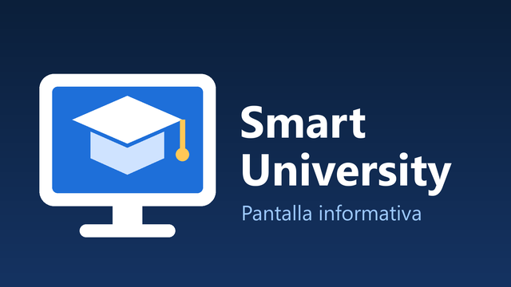

# Smart University

Aplicación para **pantallas inteligentes (Android TV)** que funciona como pantalla informativa de una universidad: muestra los **horarios de clase**, los **avisos**, los **eventos** y los **cambios de aula** del campus. Está pensada para televisiones colocadas en pasillos, vestíbulos o salas de maestros y se maneja con las flechas del control remoto.

Caso práctico de la Unidad 3 de *Desarrollo para Dispositivos Inteligentes* (caso 3: Smart University).



## Funcionalidad

| Sección | Qué hace |
| --- | --- |
| **Inicio** | Panel con reloj en vivo, clases en curso y las del siguiente bloque, avisos vigentes, próximo evento, cambios de aula del día y una cinta con los avisos urgentes. Cada panel abre su sección con OK. |
| **Horarios** | Horario semanal por grupo. Se elige el grupo y el día con chips; marca la clase *en curso*, las que ya terminaron y las que cambiaron de aula. |
| **Avisos** | Lista y detalle: al mover el foco por la lista, a la derecha se lee el aviso completo. Filtros por prioridad (urgente, importante, general). |
| **Eventos** | Cuadrícula de eventos próximos con fecha, hora, lugar y categoría; filtro por categoría. Los eventos que ya terminaron se ocultan solos. |
| **Cambios de aula** | Cambios de hoy y de los próximos días: aula anterior → aula nueva, motivo y estado (próxima, en curso, terminó). |
| **Modo pantalla** | Carrusel a pantalla completa para pasillos. Avanza cada 12 s; ◀ ▶ cambian de diapositiva y ATRÁS sale. Se activa solo tras 2 minutos sin usar el control. |
| **Administración** | Protegida con PIN (`2026` de demostración). Publicar avisos, registrar cambios de aula, retirar lo publicado, activar el modo demostración y restablecer los datos de ejemplo. Lo que se publica aparece al instante en todas las secciones. |

**Modo demostración:** fija el reloj en un día hábil a las 10:45 para enseñar la app con clases en curso a cualquier hora.

## Tecnologías

- Kotlin 2.2 y Jetpack Compose para TV (`androidx.tv:tv-material` 1.1.0).
- Arquitectura MVVM: un `ViewModel` por pantalla que expone un `StateFlow`.
- Room 2.8 para guardar clases, avisos, eventos y cambios de aula.
- `kotlinx.serialization` para leer los datos de ejemplo de `app/src/main/assets/datos_universidad.json`.
- Android Gradle Plugin 9.4, `compileSdk` 37, `minSdk` 26.

## Estructura

```
app/src/main/java/com/smartuniversity/tv/
├── SmartUniversityApp.kt        Application y contenedor de dependencias
├── MainActivity.kt
├── data/                        Entidades, DAO, Room, repositorio, reloj y reglas de negocio
├── util/Formatos.kt             Fechas y horas en español
└── ui/
    ├── theme/                   Colores y tipografía para TV
    ├── componentes/             Tarjetas enfocables, chips, reloj, etiquetas
    ├── navegacion/              Menú lateral y cambio de secciones
    ├── inicio/                  Panel principal
    ├── horarios/                Horarios por grupo y día
    ├── avisos/                  Avisos (lista y detalle)
    ├── eventos/                 Eventos próximos
    ├── cambios/                 Cambios de aula
    ├── pantalla/                Modo pantalla (carrusel)
    └── admin/                   Administración con PIN
```

## Cómo ejecutarla

1. Abrir la carpeta en Android Studio y esperar la sincronización de Gradle.
2. Crear un emulador de TV: *Device Manager → Create Virtual Device → TV → Television (1080p)* con la imagen **Android TV (API 36, x86_64)**.
3. Elegir la configuración `app` y el emulador de TV, y presionar *Run*.

Desde la terminal:

```
./gradlew assembleRelease      # APK optimizada en app/build/outputs/apk/release/
./gradlew testDebugUnitTest    # pruebas de las reglas de negocio
```

La APK de la versión publicada está en la sección *Releases* del repositorio.

## Equipo

| Integrante | Parte |
| --- | --- |
| Torres Luna Jorge Humberto | Proyecto base, capa de datos, navegación, inicio, modo pantalla y administración |
| Bazaldua Hernandez Juan Miguel | Horarios y cambios de aula |
| Vasquez Flores Andrea | Avisos y eventos |
